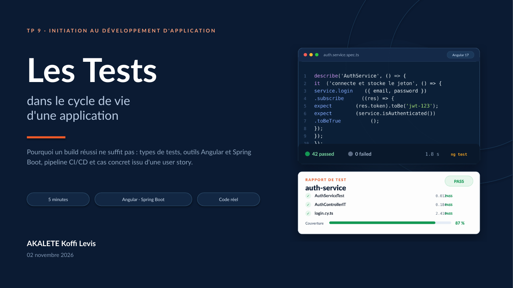

# TP9 — Les Tests · TaskFlow

[](https://github.com/akaletekoffilevis/TP9-Les-Tests/actions/workflows/tests.yml)



Support illustré et code exécutable pour le TP9 « Les Tests ».

- **Présentation** : 10 diapositives 
- **Code** : mini-application **TaskFlow** (Angular + Spring Boot) avec tests unitaires, intégration, E2E et charge.
- **CI** : un job GitHub Actions visible par test, plus un récapitulatif.

## Le parcours testé

> En tant qu'utilisateur non authentifié, je veux me connecter avec mes identifiants afin d'accéder à mon tableau de bord.

Le scénario Gherkin est dans [`code/features/login.feature`](code/features/login.feature).

## Les 8 jobs de la CI

Le workflow [`.github/workflows/tests.yml`](.github/workflows/tests.yml) se déclenche à chaque `push`, `pull_request` ou manuellement.

| # | Job                                            | Ce qui est exécuté                                                    |
| - | ---------------------------------------------- | ----------------------------------------------------------------------- |
| 1 | Angular — AuthService (unitaire)              | `auth.service.spec.ts` avec Jasmine + Karma                           |
| 2 | Spring — AuthService · identifiants valides  | `AuthServiceTest#login_avecIdentifiantsValides_retourneUnJeton`       |
| 3 | Spring — AuthService · mot de passe invalide | `AuthServiceTest#login_avecMotDePasseInvalide_leveUnauthorized`       |
| 4 | Spring — AuthController · login valide       | `AuthControllerIT#login_identifiantsValides_retourne200EtLeDashboard` |
| 5 | Spring — AuthController · login invalide     | `AuthControllerIT#login_motDePasseInvalide_retourne401`               |
| 6 | Cypress — connexion (E2E)                     | `cypress/e2e/login.cy.ts` sur l'application Angular                   |
| 7 | k6 — login (smoke)                            | `login-load-test.js` avec 2 VU pendant 5 s contre un mock API         |
| 8 | Récapitulatif                                 | tableau des résultats dans l'onglet **Summary**                  |

Chaque job de test est indépendant : un échec n'empêche pas les autres de s'exécuter. Les rapports (couverture, Surefire, Failsafe, Cypress, k6) sont publiés en artefacts.

## Lancer les tests en local

### Angular

```bash
cd code/angular
npm ci
npm test -- --watch=false --browsers=ChromeHeadlessCI --code-coverage
```

Le test E2E nécessite l'application Angular démarrée :

```bash
cd code/angular
npm start
# dans un autre terminal
npx cypress run --spec cypress/e2e/login.cy.ts
```

### Spring Boot

```bash
cd code/spring-boot
./mvnw test        # tests unitaires (Surefire)
./mvnw verify      # tests d'intégration (Failsafe)
```

Le wrapper `mvnw` utilise Maven s'il est installé ; sinon il télécharge Apache Maven 3.9.9 dans `.mvn/`.

### k6

```bash
# Smoke test local (mock API inclus)
node code/performance/mock-api.js &
SMOKE=1 VUS=2 DURATION=5s BASE_URL=http://127.0.0.1:3000 \
  k6 run code/performance/login-load-test.js

# Charge complète : 50 VU, 1 min 50
k6 run code/performance/login-load-test.js
```

## Arborescence

```text
.
├── .github/workflows/tests.yml      # 8 jobs CI
├── presentation/                    # PDF, PPTX, ODP (10 diapositives)
├── docs/                            # notice du livrable
└── code/
    ├── angular/                     # application Angular + Jasmine/Karma + Cypress
    ├── spring-boot/                 # API Spring Boot + JUnit/Mockito/MockMvc
    ├── features/login.feature       # scénario Gherkin
    └── performance/                 # test k6 + mock API
```

## Portée du code

Ce dépôt est un **support pédagogique exécutable**, pas une application de production :

- l'authentification est volontairement minimale (un utilisateur en base H2, un JWT signé avec une clé de démonstration) ;
- le mock k6 vérifie le scénario de charge, pas la logique métier Spring ;
- les tests Spring couvrent le service et le contrôleur, pas l'ensemble de l'application.

La présentation complète explique la démarche.
